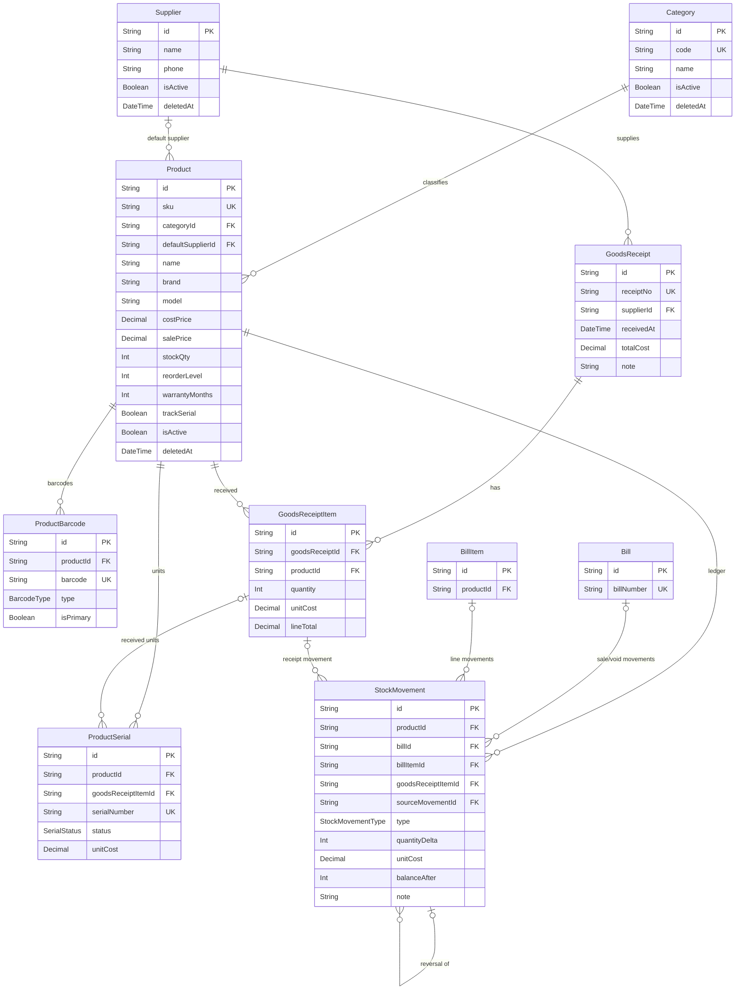
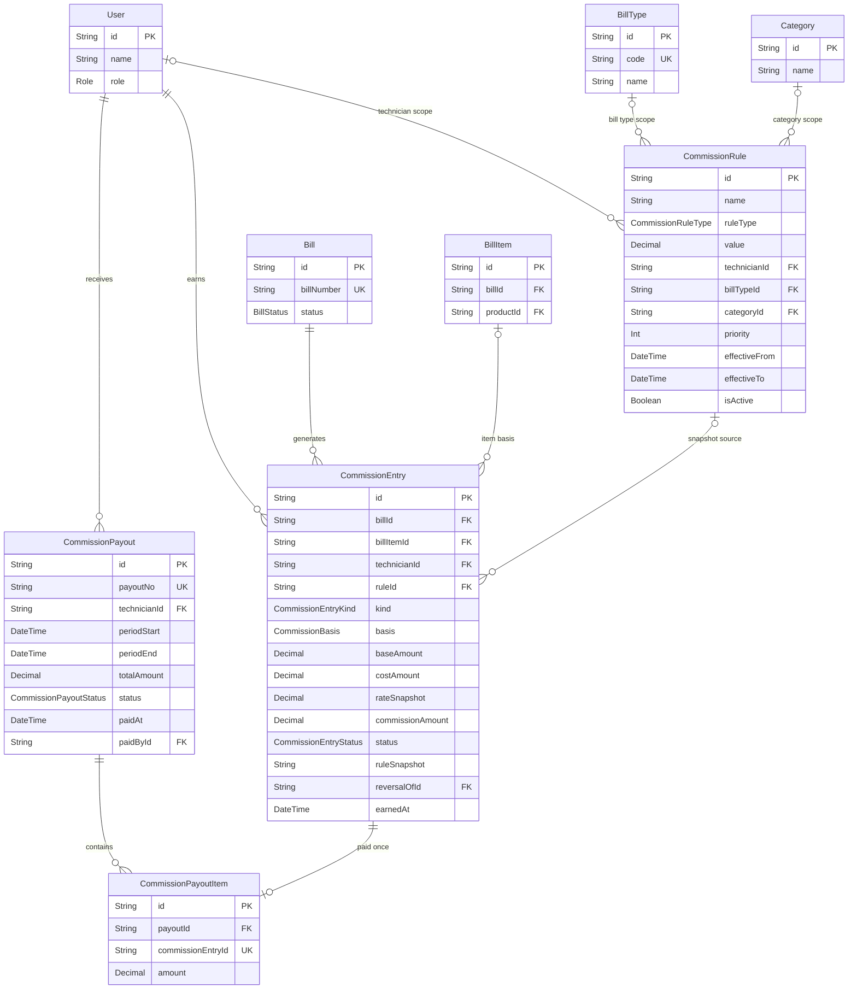

# Phase 0 — ERD และข้อกำหนดฐานข้อมูล (ฉบับร่าง)

> รออนุมัติก่อน implement
> ข้อมูลทุกตารางมี `createdAt`, `updatedAt`, `createdById` (FK → User, nullable เฉพาะ record ที่สร้างโดยระบบ) เว้นแต่ระบุไว้เป็นอย่างอื่น
> เงินทุกฟิลด์เป็น `Decimal(12,2)`; อัตราเปอร์เซ็นต์เป็น `Decimal(7,4)`; จำนวนสินค้าเป็น `Int`
> ใช้ `Asia/Bangkok` ในการแสดงผลและจัดกลุ่มรายงาน

## 1. Core: ผู้ใช้ ลูกค้า บิล และรายละเอียดเฉพาะประเภท

```mermaid
erDiagram
    User {
        String id PK
        String email UK
        String name
        Role role
        Boolean isActive
        Int tokenVersion
    }
    Customer {
        String id PK
        String name
        String phone UK
        String email
        String taxId
        DateTime deletedAt
    }
    BillType {
        String id PK
        String code UK
        String name
        String prefix UK
        Boolean requiresRepairDetail
        Boolean requiresWarrantyCheck
        Boolean isActive
    }
    Bill {
        String id PK
        String billNumber UK
        String billTypeId FK
        String customerId FK
        String technicianId FK
        BillStatus status
        String title
        Decimal subtotal
        DiscountType discountType
        Decimal discountValue
        Decimal discountAmount
        Boolean vatEnabled
        Decimal vatRate
        Decimal vatAmount
        Decimal grandTotal
        PaymentMethod paymentMethod
        DateTime approvedAt
        DateTime paidAt
        DateTime voidedAt
        String rejectionReason
        String voidReason
    }
    BillItem {
        String id PK
        String billId FK
        BillItemKind kind
        String productId FK
        String description
        Int quantity
        Decimal unitPrice
        Decimal unitCost
        DiscountType lineDiscountType
        Decimal lineDiscountValue
        Decimal lineDiscountAmount
        Decimal lineTotal
        Int warrantyMonths
    }
    BillItemSerial {
        String id PK
        String billItemId FK
        String productSerialId FK
        DateTime warrantyStartAt
        DateTime warrantyEndAt
        DateTime releasedAt
    }
    ProductSerial {
        String id PK
        String productId FK
        String serialNumber UK
        SerialStatus status
        DateTime soldAt
        DateTime warrantyStartAt
        DateTime warrantyEndAt
    }
    Product {
        String id PK
        String sku UK
    }
    BillRepairDetail {
        String id PK
        String billId UK
        String deviceBrand
        String deviceModel
        String deviceSerial
        String reportedSymptoms
        String diagnosis
        String resolution
        RepairStatus repairStatus
    }
    BillWarrantyClaim {
        String id PK
        String billId UK
        String productId FK
        String originalBillId FK
        String originalBillItemId FK
        String productSerialId FK
        WarrantyCheckResult checkResult
        DateTime originalSaleAt
        DateTime warrantyEndsAt
        DateTime checkedAt
        String adminNote
    }
    BillStatusHistory {
        String id PK
        String billId FK
        BillStatus fromStatus
        BillStatus toStatus
        String reason
        String changedById FK
        DateTime changedAt
    }
    DocumentSequence {
        String id PK
        String key UK
        Int lastNumber
    }

    User ||--o{ Bill : "technician"
    Customer ||--o{ Bill : "owns"
    BillType ||--o{ Bill : "type"
    Bill ||--o{ BillItem : "contains"
    Product |o--o{ BillItem : "product (optional)"
    Product ||--o{ ProductSerial : "units"
    BillItem ||--o{ BillItemSerial : "sold serials"
    ProductSerial ||--o{ BillItemSerial : "sale history"
    Bill ||--o| BillRepairDetail : "repair detail"
    Bill ||--o| BillWarrantyClaim : "claim detail"
    Bill ||--o{ BillStatusHistory : "status history"
    User ||--o{ BillStatusHistory : "changed by"
```

**หมายเหตุ Bill**

- `technicianId` = ผู้รับผิดชอบบิล (ใช้คิดคอม), `createdById` = ผู้สร้าง; อาจเป็นคนเดียวกันหรือ Admin สร้างแทนก็ได้
- `BillItem` เก็บ snapshot ของชื่อสินค้า/ราคา/ต้นทุน/ประกัน เพื่อไม่ให้ข้อมูลเก่าเปลี่ยนตาม master data
- `BillItemSerial` เก็บประวัติการขาย Serial; Void จะตั้ง `releasedAt` ไม่ลบประวัติ
- `BillWarrantyClaim.originalBillId/originalBillItemId` เป็น snapshot อ้างอิงประวัติเดิม; `checkResult` เก็บผลตอนตรวจและ `adminNote` ใช้เมื่อไม่มีประวัติหรือ override

## 2. Inventory: สินค้า คลัง Serial และการเคลื่อนไหว

**หมายเหตุ Inventory**

- ยอด `Product.stockQty` เป็นยอด denormalized เพื่อความเร็ว; ห้ามแก้ตรงจาก UI และต้องเปลี่ยนพร้อม `StockMovement` ใน transaction เดียว
- `ProductBarcode.barcode` unique; หนึ่งสินค้ามีได้หลาย barcode
- `ProductSerial.serialNumber` unique ระดับร้าน; Serial ใช้ตรวจประกันและตรวจก่อนเคลม
- `StockMovement.quantityDelta` เป็นค่าบวก/ลบแบบ signed; `sourceMovementId` ใช้อ้างอิงรายการเดิมเมื่อ Void/กลับรายการ
- Goods Receipt เป็นเอกสารรับเข้าที่ posted ทันที; การแก้ยอดต้องใช้ adjustment movement พร้อมเหตุผล ไม่แก้ receipt เดิม

## 3. Commission

**หมายเหตุ Commission**

- `CommissionEntry` เก็บ snapshot ทั้งกติกา ค่า rate ฐาน และต้นทุน; แก้ rule ภายหลังไม่มีผลกับ entry เก่า
- Void หลังอนุมัติ: entry เดิมถูก mark `REVERSED`; สร้าง entry ติดลบใหม่ด้วย `kind=REVERSAL`, `reversalOfId` ชี้รายการเดิม
- Entry ที่จ่ายแล้วยังคงอยู่ใน payout เดิม; ยอด reversal ติดลบจะถูกหักในรอบถัดไป (ต้องยืนยันแนวนโยบาย)
- หนึ่ง entry อยู่ใน payout ได้ครั้งเดียวด้วย constraint unique ที่ `CommissionPayoutItem.commissionEntryId`

## 4. ตารางประกอบและฟิลด์สำคัญ

| ตาราง | หน้าที่ / ฟิลด์สำคัญ |
|---|---|
| `User` | บัญชีผู้ใช้; email unique, passwordHash, role, isActive, tokenVersion (invalidate session หลัง reset password), lastLoginAt, deactivatedAt |
| `Customer` | ลูกค้า; phone (normalized) unique, email, address, taxId, note, deletedAt; ห้าม hard delete |
| `Category` | หมวดสินค้า; code unique, name, isActive, deletedAt |
| `Product` | SKU unique, ราคาทุน/ขาย, stockQty, reorderLevel, warrantyMonths, trackSerial, isActive, deletedAt |
| `ProductBarcode` | barcode unique, type `CODE128/EAN13`, isPrimary; หลายรายการต่อสินค้า |
| `ProductSerial` | หน่วยสินค้าที่มี Serial; status `IN_STOCK/SOLD/CLAIMED/DISPOSED`, unitCost, soldAt, warrantyStartAt, warrantyEndAt |
| `Supplier` | ผู้ขาย/ผู้จัดส่ง; soft delete |
| `GoodsReceipt` | ใบรับเข้า; receiptNo unique, supplierId, receivedAt, totalCost |
| `GoodsReceiptItem` | รายการรับเข้า; quantity, unitCost, lineTotal; สร้าง Serial ได้ |
| `StockMovement` | ledger ทุกการเปลี่ยนสต๊อก; type, quantityDelta, unitCost, balanceAfter, billId/billItemId/goodsReceiptItemId/sourceMovementId, note |
| `BillType` | ประเภทบิลแบบ table เพื่อเพิ่มในอนาคต; code/prefix unique, flags สำหรับฟอร์มซ่อม/เคลม |
| `DocumentSequence` | running number ต่อ `prefix-ปี`; อัปเดตด้วย row lock ใน transaction |
| `Bill` | เลขบิล, type, customer, technician, สถานะ, ยอดเงิน, VAT snapshot, payment, approval/reject/void metadata, stockDeductedAt/stockRestoredAt |
| `BillItem` | line item; kind `PRODUCT/SERVICE`, productId (ถ้ามี), snapshot ราคา/ต้นทุน/ประกัน, quantity, discounts, lineTotal |
| `BillItemSerial` | จับคู่ line item กับ ProductSerial, snapshot ประกัน, releasedAt เมื่อ Void |
| `BillRepairDetail` | ข้อมูลเครื่อง, อาการ, การตรวจ/แก้ไข, repairStatus; 1-1 กับ Bill |
| `BillWarrantyClaim` | ตรวจประวัติซื้อ; original bill/item/serial, checkResult, วันหมดประกันเดิม, adminNote |
| `BillStatusHistory` | audit เฉพาะ workflow; from/to status, reason, changedById, changedAt |
| `CommissionRule` | rule type, value, scope (technician/billType/category), priority, effectiveช่วงวันที่, isActive |
| `CommissionEntry` | รายการคอม; kind earning/reversal, basis, base/cost/rate snapshot, ruleSnapshot JSON, status, reversalOfId |
| `CommissionPayout` | รอบจ่ายต่อช่าง; payoutNo, periodStart/End, totalAmount, paidById/paidAt |
| `CommissionPayoutItem` | join entry ↔ payout, amount; unique entry |
| `AuditLog` | actorId, action, entityType/entityId, before/after JSON, ip, userAgent, createdAt |
| `AppSetting` | singleton ตั้งค่าร้าน; ชื่อ/ที่อยู่/เลขภาษี, vatEnabled, vatRate, vatIncluded, receiptFooter |
| `RateLimitBucket` | fixed-window rate limit; key unique (email/IP), count, windowStart, blockedUntil |

**Auth.js:** ใช้ JWT session จึงไม่ต้องมีตาราง Session/Account ของ adapter; ยังใช้ User ของเราเองและตรวจ active/tokenVersion ที่ server ทุกครั้งที่ทำ action สำคัญ

## 5. Constraint และ Index ที่เสนอ

Unique:
- `User.email` (เก็บ lowercase), `Customer.phone` (normalize), `Product.sku`, `ProductBarcode.barcode`, `ProductSerial.serialNumber`, `Bill.billNumber`, `GoodsReceipt.receiptNo`, `BillType.code/prefix`, `DocumentSequence.key`, `CommissionPayout.payoutNo`, `CommissionPayoutItem.commissionEntryId`

Index หลัก:
- `Customer(phone)`, `Customer(name)`, `Customer(createdAt)`
- `Product(sku)`, `Product(categoryId,isActive)`, `Product(name)`, `Product(stockQty,reorderLevel)`
- `ProductBarcode(barcode)`, `ProductSerial(serialNumber)`, `ProductSerial(productId,status)`, `ProductSerial(warrantyEndAt)`
- `Bill(billNumber)`, `Bill(status,createdAt)`, `Bill(technicianId,status,createdAt)`, `Bill(customerId,createdAt)`, `Bill(createdAt)`
- `BillItem(billId)`, `BillItem(productId)`, `BillItemSerial(productSerialId)`, `BillItemSerial(billItemId)`
- `StockMovement(productId,createdAt)`, `StockMovement(billId)`, `StockMovement(type,createdAt)`
- `BillStatusHistory(billId,createdAt)`
- `CommissionEntry(technicianId,status,earnedAt)`, `CommissionEntry(billId)`, `CommissionEntry(reversalOfId)`
- `CommissionRule(isActive,effectiveFrom,effectiveTo)`; index scope columns
- `AuditLog(entityType,entityId)`, `AuditLog(actorId,createdAt)`, `AuditLog(createdAt)`
- `BillItemSerial` ควรมี partial/application guard ว่า Serial หนึ่งชิ้นอยู่ในบิลที่ยัง active ได้ครั้งเดียว; ตรวจใน transaction

Check constraints (เพิ่มใน SQL migration):
- ราคา/ยอดเงิน ≥ 0, quantity > 0
- `Product.stockQty >= 0`
- discount amount ≤ ยอดก่อนส่วนลด
- เปอร์เซ็นต์อยู่ในช่วง 0–100
- `Bill` ต้องมี `technicianId/customerId`; Approved/Paid ต้องมี `approvedAt`; VOIDED ต้องมี `voidReason` และ `voidedAt`
- VAT amount/commission amount คำนวณและเขียนจาก server เท่านั้น

## 6. Transaction boundaries ที่ต้องบังคับ

1. **Approve Bill**
   - lock Bill (ตรวจสถานะ Pending)
   - lock/validate stock rows และ Serial ตามลำดับ `productId` เพื่อกัน deadlock
   - ตรวจ stock พอ, ตัด stock, เขียน StockMovement `SALE`
   - ผูก Serial/Warranty snapshot
   - คำนวณ CommissionEntry + snapshot
   - เปลี่ยนสถานะ + BillStatusHistory + AuditLog
   - commit ทั้งหมด; ถ้าขั้นใดล้มเหลวให้ rollback
2. **Void Bill**
   - lock Bill, ตรวจสิทธิ์ Admin และสถานะ
   - คืน stock + StockMovement `VOID_RESTOCK` อ้าง movement เดิม
   - คืน Serial, ปิด warranty link
   - reverse commission entry
   - เปลี่ยนสถานะ + history + audit
3. **Goods Receipt**
   - lock sequence, สร้าง receipt + items
   - เพิ่ม stock, สร้าง Serial ถ้า trackSerial, เขียน StockMovement `GOODS_RECEIPT`
   - อัปเดต weighted-average cost (ถ้าเลือกวิธีนี้)
4. **Commission Payout**
   - lock entries ที่จะจ่าย, ตรวจว่ายัง PENDING และไม่ถูก reverse
   - สร้าง payout + items, mark entries PAID
5. **Submit / Reject / Mark Paid** ทำใน transaction พร้อม history + audit

ใช้ `SERIALIZABLE` หรือ row locks ตามจุดที่แข่งขัน และ retry เฉพาะ transaction conflict; ห้าม retry แบบที่ทำให้ตัด stock ซ้ำ

